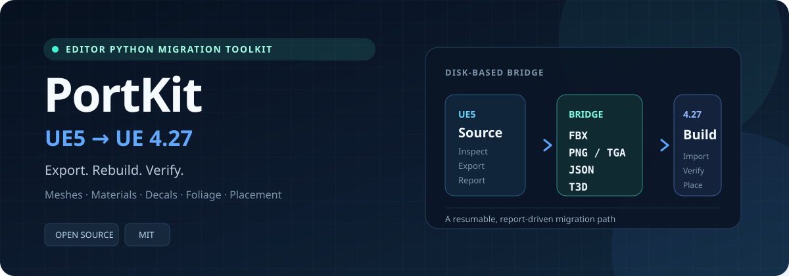

<p align="center">
  
</p>

# PortKit

**Move UE5 asset packs into Unreal Engine 4.27 without opening a `.uasset` across engine versions.**

PortKit is an Editor Python toolkit for inspecting, exporting and rebuilding UE5
meshes, textures, materials, decals and Blueprint-placement instances in UE 4.27.
It uses disk-based interchange formats: **FBX, PNG/TGA, JSON and material T3D dumps**.

**PortKit 是一个将 UE5 资源包迁移并重建到 UE 4.27 的 Editor Python 工具包。**
它先探查资源，再从 UE5 导出中间格式，最后在 UE 4.27 中重建、摆放并生成可追溯的报告。

[](https://github.com/moyanxingyun/ue5-to-ue427-port/actions/workflows/tests.yml)
[](LICENSE)


> [!IMPORTANT]
> PortKit does not include or redistribute third-party asset packs. You run the
> scripts against assets that already exist on your own machine. Validate results
> in-editor before shipping.

## Why PortKit

UE5 assets cannot be opened directly by UE 4.27. A reliable migration therefore
needs two separate operations:

1. **Export in UE5** to formats both engines can read.
2. **Rebuild in UE 4.27** with explicit configuration, reports and recovery paths.

PortKit packages those operations into reproducible stages instead of requiring
users to rebuild each asset pack with a different one-off script.

## Migration pipeline

| Stage | Engine | What it produces |
|---|---|---|
| Probe | UE5 + UE4.27 | Asset inventory, material-switch combinations, available 4.27 Python APIs |
| Export | UE5 | FBX, PNG/TGA, material JSON, texture maps, Blueprint transforms and material T3D dumps |
| Rebuild | UE4.27 | Imported meshes, textures, simplified materials, decals and foliage |
| Material transplant | UE4.27 | Baker-ready full material graphs for selected switch combinations |
| Place | UE4.27 | Rebuilt Blueprint placement instances attached to a single root |
| Verify / clean up | UE4.27 | LOD, texture, compilation and reconstruction reports |

## Features

- **Safe probing first.** Read-only scripts summarize an asset pack before assets
  are written or modified.
- **Simplified and full material paths.** Start with tint, contrast, normal, ORM and
  emissive reconstruction; use full graph baking only where appearance requires it.
- **Switch-aware material reconstruction.** Bakes only the static-switch
  combinations actually referenced by material instances.
- **Placement recovery.** Rebuilds selected Blueprint instances from exported
  transforms and attaches large batches without selecting thousands of Actors.
- **Recoverable workflows.** Reports, resumable batches and fallback switching are
  built into the material transplant path.
- **UE 4.27 Python workarounds.** Handles unavailable pins and properties, channel
  mismatches, `PositiveClampedPow`, decal blend modes and protected material graphs
  without silently assuming connections succeeded.

## Requirements

| Workload | Environment |
|---|---|
| Export and probe | Unreal Engine 5.4 Editor Python |
| Rebuild and diagnostics | Unreal Engine 4.27 Editor Python 3.7 |
| Offline parser and tests | Python 3.7+ |

The scripts are designed to be run by the user from Unreal Editor's **Output Log →
Cmd** mode. PortKit does not remotely operate an Unreal Editor session.

## Quick start

### 1. Get PortKit

```powershell
git clone https://github.com/moyanxingyun/ue5-to-ue427-port.git
cd ue5-to-ue427-port
```

### 2. Create a pack-specific config

```powershell
Copy-Item .\scripts\config_example.json .\my-pack-config.json
```

Fill in:

- UE5 content roots and material/Blueprint paths
- Export and report directories
- UE 4.27 `/Game` destinations
- Material parameter names and foliage/decal options

Every entry script accepts `--config PATH` or the `PORTKIT_CONFIG` environment
variable. Personal configs and exported assets are ignored by Git.

### 3. Probe and export in UE5

Run this in UE5's Output Log with the correct project open:

```text
py "C:/path/to/ue5-to-ue427-port/scripts/ue5/probe_pack.py" --config "C:/path/to/my-pack-config.json"
```

Review the generated summary, then run only the exporters required by the pack:

- `export_meshes.py`
- `export_all_mis.py`
- `export_foliage.py`
- `export_texture_pack.py`
- `export_bp_instances.py`
- `export_bp_spawn.py`
- `dump_graphs.py`

### 4. Probe and rebuild in UE 4.27

Open the target UE 4.27 project and run:

```text
py "C:/path/to/ue5-to-ue427-port/scripts/ue427/probe_ue427.py" --config "C:/path/to/my-pack-config.json"
```

Start with `import_assets.py`, `import_foliage.py` or `import_decals.py`. Use the
`material_transplant/` workflow only when simplified materials cannot preserve
the pack's appearance. Finish with placement and read-only diagnostics.

## Use as a Codex skill

```powershell
$target = Join-Path $env:USERPROFILE ".codex\skills\ue5-to-ue427-port"
git clone https://github.com/moyanxingyun/ue5-to-ue427-port.git $target
```

Invoke it explicitly as `$ue5-to-ue427-port`. The skill routes detailed material
transplant and reporting rules through the files in [`references/`](references/).

## Reports and recovery

Every workflow writes machine-readable or text reports. Read the reports before
continuing to the next stage:

- probe summaries and unavailable API inventories
- export counts, failures and source project identity
- material planning, unsupported-node and test-mode results
- connection checks, rebuild logs and verification output
- LOD, texture and import diagnostics

Keep the generated reports with your migration notes. Do not publish reports that
contain private project names, local paths or proprietary asset metadata.

## Known limitations

- Blueprint logic and construction-script behavior cannot be transferred; only
  generated placement can be recovered.
- Niagara, landscape/foliage type assets, volume clouds, sky configuration,
  Nanite-only effects, Lumen settings, Substrate, virtual textures and UE5
  Material Layer assets are not migrated.
- UE5 and UE 4.27 have different lighting and material models. Visual parity
  requires in-editor verification.
- Full material reconstruction can create many baked masters. Review the planner
  output and enforce a sensible cap.

See [`SKILL.md`](SKILL.md) for the operational rules and
[`references/material-transplant.md`](references/material-transplant.md) for the
full material workflow.

## Tests

```powershell
python -m unittest discover -s scripts/tests -v
```

The suite covers T3D parsing, material rules, `PositiveClampedPow` output types,
planner contracts and foliage metadata. Fixture-dependent tests are skipped when
private reference corpora are not available.

## English overview

PortKit exports UE5 packs as FBX, PNG/TGA, JSON and material node dumps, then
rebuilds them in UE 4.27. It provides probe, simplified rebuild, full material
transplant, decal, foliage, Blueprint placement and diagnostic workflows. Scripts
run inside Unreal Editor, write reports and never redistribute the source asset
pack. See the quick-start section above for the runnable entry points.

## Contributing

Bug reports, import-failure details and reproducible test cases are welcome.
Please read [CONTRIBUTING.md](CONTRIBUTING.md) before opening a pull request.
Do not upload proprietary assets, personal configs or unsanitized logs.

If PortKit saves you time, a star helps other Unreal Engine developers discover it:

**https://github.com/moyanxingyun/ue5-to-ue427-port**

## License

[MIT](LICENSE) © 2026 PortKit contributors.
